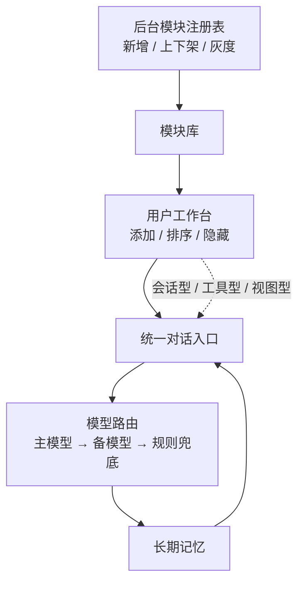
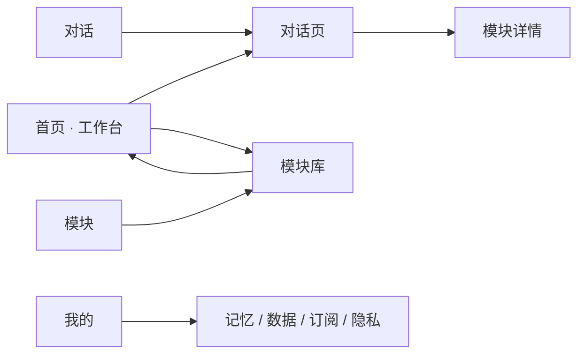
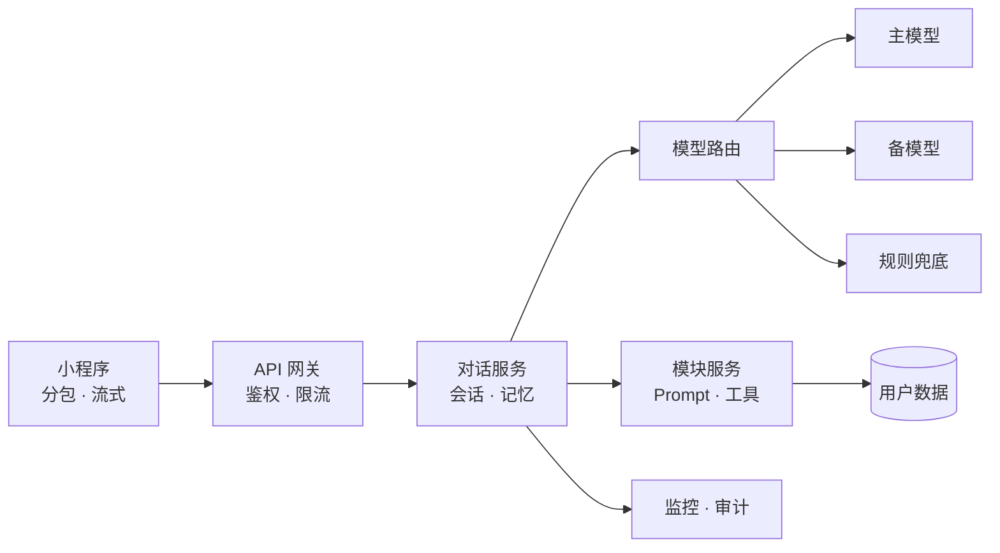

# 长伴 · 终身 AI 智能助手小程序

## 产品方案 v0.1

| 项目 | 内容 |
| --- | --- |
| 文档版本 | v0.1 |
| 日期 | 2026-11-24 |
| 作者 | 产品专家 王文哲 |
| 状态 | 待评审 |
| 默认载体 | 微信小程序（企业主体） |
| 一句话 | 能力在后台生长，界面由你决定，数据始终归你 |

---

## 0. 输入说明与待确认项

**输入解读**

- 原文「维修小程序」按 **AI 智能助手小程序** 理解：描述中全部是「终身智能助手、AI 能力、工作/开发/学习/日常」，无维修业务特征，判断为笔误。
- 平台默认 **微信小程序**；如果是支付宝/抖音小程序，架构不变，仅登录与支付接入层替换。
- 商业模式默认「免费 + 订阅」，若坚持完全免费，第 8 章成本模型需重新配平。

**待确认（不阻塞方案，但影响排期与预算）**

| 编号 | 待确认项 | 默认假设 |
| --- | --- | --- |
| Q1 | 主体资质：企业 / 个人 | 企业主体（AI 对话类目与备案的前提） |
| Q2 | 首发是否面向国内用户 | 是，数据境内存储、走国内模型 |
| Q3 | 是否接受订阅收费 | 接受，免费额度 + Pro 订阅 |
| Q4 | 是否需要 Web / App 多端 | V2 再评估 |

---

## 1. 产品定义

**一句话定位**：一个会陪你十年、并随你习惯生长的 AI 助手。

**对用户只讲三句话**

1. 能力在后台生长——不用换 App，新功能自己长出来。
2. 界面由你决定——只留下你真正会用的模块。
3. 数据始终归你——随时导出，随时离开。

**三个「不依赖」（长期可用性的底层设计）**

| 不依赖 | 做法 | 用户得到什么 |
| --- | --- | --- |
| 不依赖单一模型 | 模型路由层，主/备/兜底三档 | 某家模型涨价、下线，服务不断 |
| 不依赖固定界面 | 模块注册表 + 用户工作台 | 十年后界面仍合手 |
| 不依赖平台独占数据 | 全量导出（Markdown / JSON） | 不被绑架，反而更敢长期用 |

**刻意不做**：社区、内容广场、电商、团队协作、硬件绑定。任何让首页变重的东西，首版都不做。

**命名建议**：长伴（主推，情感向）｜常在（中性）｜久伴（亲和）。均为工作名，上线前需做商标与平台重名检索。

---

## 2. 用户与场景

| Persona | 特征 | 核心诉求 | 付费意愿 |
| --- | --- | --- | --- |
| 独立开发者 / 自由职业 | 28–35 岁，一人多岗 | 写文档、查报错、整理资料，一个入口搞定 | 高 |
| 学生 / 备考人群 | 18–24 岁，预算敏感 | 讲解、出题、复习计划、翻译 | 低，靠免费额度 |
| 职场通勤族 | 25–40 岁，碎片时间 | 写周报、润色邮件、行程规划 | 中 |

**高频场景**

| 场景 | 当前痛点 | 产品解法 |
| --- | --- | --- |
| 写周报 / 邮件 | 打开多个工具，来回粘贴 | 写作模块，预置语气与模板 |
| 学新东西 | 只会问，不会复习 | 学习模块带出题与复习计划 |
| 资料速读 | 长 PDF 看不完 | 文件速读，摘要 + 追问 |
| 生活杂事 | 记了但找不到 | 对话里直接记，按时间回看 |
| 开发排错 | 报错看不懂 | 代码模块，贴片段即解释 |

**三条用户故事（验收时逐条对照）**

1. 作为一个赶周报的上班族，我打开小程序说一句「帮我写本周周报」，30 秒拿到初稿，不用选功能、不用填表。
2. 作为一个只用翻译和待办的用户，我的首页只有两个卡片，其余模块在库里躺着，不占地方。
3. 作为一个用了两年的老用户，我换手机后登录，历史对话与偏好都在，并能一键导出全部数据。

---

## 3. 产品结构：一套对话，两层配置

### 3.1 核心原则

> **所有模块最终都收敛到「对话」这一种交互原语。**

模块不是新页面，而是「预置的上下文 + 可用工具 + 可选数据视图」。这样功能可以无限增加，界面复杂度却不增长——这是「简单明了」的结构性保证。

### 3.2 模块模型

一个模块 = 元数据 + 能力包 + 数据视图 + 策略。

| 组成 | 内容 |
| --- | --- |
| 元数据 | 名称、一句话说明、分类、图标、排序权重 |
| 能力包 | System Prompt、工具白名单（联网/计算/文件解析）、模型档位 |
| 数据视图 | 可选。绑定一类用户数据（如笔记、日程、学习记录） |
| 策略 | 可见范围、灰度比例、最低客户端版本、免费/Pro |

### 3.3 后台配置字段（运营可自助）

| 字段 | 说明 | 示例 |
| --- | --- | --- |
| module_id | 全局唯一，创建后不可改 | writing |
| 名称 / 副标题 | 卡片与搜索展示 | 写作助手 / 润色、改写、邮件 |
| 分类 | 工作 / 学习 / 生活 / 创作 / 开发 | 工作 |
| 类型 | 会话型 / 工具型 / 视图型 | 会话型 |
| prompt_ref | 提示词模板版本 ID | writing.v3 |
| tools | 工具白名单 | web_search, file_read |
| model_policy | 默认档位与最大输出 | standard / 2k |
| entry_schema | 工具型表单字段定义 | 非工具型为空 |
| storage | 视图型绑定的数据集合 | notes |
| audience | 全员 / 白名单 / 百分比灰度 | 5% |
| min_client | 最低客户端版本 | 1.1.0 |
| tier | 免费 / Pro | 免费 |
| status | 草稿 / 上架 / 下架 | 上架 |

**约束**：模块下架不删除用户数据；已添加该模块的用户看到「已下线」提示，可移除并导出数据。

### 3.4 用户配置规则（保持简单的硬限制）

- 首屏模块 **≤ 8 个**，推荐 3–5 个。
- 支持「添加 / 移除 / 拖拽排序 / 隐藏」；隐藏保留数据，移除进入回收站 30 天。
- 提供「恢复推荐配置」一键重置。
- 配置只在两处：工作台编辑态、模块详情页。**不设第三层设置。**
- 通用问答常驻且不可移除，作为兜底入口。

### 3.5 三种模块形态

| 形态 | 交互 | 例子 |
| --- | --- | --- |
| 会话型 | 点卡片 → 带预置 Prompt 的对话 | 写作、学习、翻译、代码 |
| 工具型 | 表单 → 结果（结果可转入对话） | 文件速读、OCR |
| 视图型 | 列表/看板 + 对话入口 | 日程待办、灵感笔记 |

### 3.6 反模式（明确不采用）

- ❌ 每个模块一个底部 Tab——模块一多，导航就崩。
- ❌ 首页做信息流/推荐位——助手不是内容产品。
- ❌ 模块内再套复杂设置树——超过两级配置即视为设计缺陷。
- ❌ 用弹窗做新手引导——用示例问题替代教程。

---

## 4. 功能清单（MoSCoW）

| 级别 | 功能 | 说明 |
| --- | --- | --- |
| **Must** | 微信登录与账号 | 一键登录，手机号可选；支持注销 |
| **Must** | 对话 | 流式输出、多轮、历史、复制、重新生成 |
| **Must** | 模块库 + 工作台 | 添加、移除、排序、隐藏、恢复推荐 |
| **Must** | 首发 8 个模块 | 通用问答、写作、学习、翻译、日程待办、文件速读、灵感笔记、代码助手 |
| **Must** | 长期记忆 | 偏好/事实/项目三层，可查看、编辑、删除 |
| **Must** | 内容安全 | 输入输出双向审核，命中即拦截 |
| **Must** | 数据导出与注销 | Markdown / JSON 全量导出 |
| **Should** | 语音输入 | 通勤场景刚需 |
| **Should** | 图片理解 | 拍照解题、截图转文字 |
| **Should** | 收藏与快捷指令 | 常用问法存为一句话入口 |
| **Should** | 深色模式 | 跟随系统 |
| **Could** | 用户自建模块 | 自定义 Prompt + 图标，存为个人模块 |
| **Could** | 每日回顾 | 每天一条昨日要点，制造使用仪式 |
| **Could** | 服务通知 | 待办提醒、周报提醒 |
| **Won't（V1）** | 多助手人格、插件市场、团队协作、开放 API | 增加复杂度，收益不明 |

**MVP 边界**：对话 + 模块框架 + 工作台 + 4 个模块（通用问答、写作、翻译、日程）+ 记忆 + 合规。其余按路线图迭代。

---

## 5. 信息架构与关键流程

### 5.1 页面地图

四个底部 Tab：首页 · 对话 · 模块 · 我的。对话同时是页面和 Tab，从首页输入框进入时复用同一页面。

### 5.2 首次进入（目标：30 秒内发出第一条消息）

1. 微信授权（昵称头像可选，不强制手机号）。
2. 推荐 3 个模块默认选中，一屏可「全都要 / 自己挑 / 先跳过」。
3. 直接落到首页，输入框自动聚焦，下方给 3 条示例问题。
4. 发出第一条消息即完成激活。**全程无教程、无弹窗。**

### 5.3 添加模块

模块库 → 分类或搜索 → 点「添加」→ 工作台即时出现（无需刷新）→ 轻提示「已添加到首页」。

### 5.4 日常使用

首页输入 → 对话页；点模块卡片 → 带预置 Prompt 的对话；长按卡片 → 进入编辑态（拖拽 / 隐藏 / 移除）。

### 5.5 退出与迁移

我的 → 数据与隐私 → 导出（Markdown + JSON，邮件或直接下载）→ 注销（二次确认，7 天冷静期，可撤销）。

---

## 6. 视觉与交互规范

**基调**：暖白底、墨青一点、细边框、无阴影。安静，不抢内容。

### 6.1 Design Token

| Token | 值 | 用途 |
| --- | --- | --- |
| --bg | #F7F7F5 暖白 | 页面底色 |
| --surface | #FFFFFF | 卡片、输入区 |
| --fg | #1C1C1A | 主文字 |
| --muted | #8B8B86 | 次要文字、占位符 |
| --border | #E8E8E4 | 分割线、卡片描边 |
| --accent | #2F6A5B 墨青 | 主色，仅用于强调 |
| --warning / --error | #B4762F / #A4443C | 状态 |

### 6.2 字体与间距

| 层级 | 字号 | 字重 | 用途 |
| --- | --- | --- | --- |
| 大标题 | 28rpx→56rpx | 600 | 页面标题 |
| 标题 | 34rpx | 600 | 卡片标题 |
| 正文 | 30rpx | 400 | 对话、说明 |
| 辅助 | 26rpx | 400 | 时间、状态 |
| 最小 | 22rpx | 400 | 标签 |

行高 1.6；间距只用 8 / 16 / 24 / 32 / 48 rpx；卡片圆角 32rpx，按钮胶囊 999rpx；图标 1.5px 线性、单色。

### 6.3 六条硬规则

1. 一屏只有一个主动作（首页 = 输入框）。
2. 主色面积 ≤ 10%，其余全是灰阶。
3. 卡片用 1px 细边框，不用投影；只有浮层允许一层极淡阴影。
4. 配置层级 ≤ 2，任何设置不超过两次点击可达。
5. 空状态给 3 条示例问题，不给教程页。
6. 动效只做状态反馈，150ms ease-out；不做装饰性动画。

### 6.4 可访问性

正文对比度 ≥ 4.5:1；点击区 ≥ 88rpx；深色模式跟随系统，不单独开关；字号跟随系统设置。

---

## 7. 技术架构与「稳定可靠」

### 7.1 架构

### 7.2 稳定性设计（核心卖点的工程落点）

| 机制 | 做法 |
| --- | --- |
| 模型降级 | 主模型超时 8s 未出首字 → 切备模型；全失败 → 规则应答 + 明确提示 |
| 流式输出 | `wx.request` 开启 chunked；生成中可中断；断线后按 message_id 续拉已生成部分 |
| 幂等 | 客户端 client_msg_id 去重，弱网重发不重复计费 |
| 不丢输入 | 输入草稿本地保存，任何失败都可一键重发 |
| 记忆一致 | 记忆异步写入、带版本；冲突时以用户最近确认的为准 |
| 版本兼容 | 模块带 schema version，旧客户端只下发兼容字段 |
| 灰度发布 | 5% → 50% → 100%，异常自动回滚 |
| 可观测 | 成功率、P95 首字延迟、token 消耗、错误分布四张看板 |

### 7.3 记忆设计

三层：**会话记忆**（当前上下文）→ **偏好记忆**（语气、称呼、格式习惯）→ **事实记忆**（长期有效的个人信息与项目）。用户可在「我的 → 记忆」中逐条查看、修改、删除；每条记忆标注来源与时间，避免「AI 记错了还改不掉」。

### 7.4 小程序工程约束

- 主包 ≤ 2MB，总包 ≤ 20MB：模块页面全部走分包，模块配置由后台下发，新增模块不触发发版。
- 登录：`wx.login` + code2session；手机号按需授权。
- 流式：`wx.request` 的 `enableChunked` 或 WebSocket，二选一，MVP 用前者。
- 存储：对话与记忆存服务端（自建），本地只缓存草稿与最近会话，换机不丢。
- 内容安全：`security.msgSecCheck` v2 + `mediaCheckAsync`，服务端再叠加一层规则与模型审核。

### 7.5 合规清单（**最高优先级风险，P0 即启动**）

| 事项 | 要求 | 阶段 |
| --- | --- | --- |
| 主体与类目 | 企业主体；AI 对话相关服务类目需与平台最新政策匹配 | P0 |
| 生成式 AI 备案 | 面向公众提供生成式 AI 服务，需按《生成式人工智能服务管理暂行办法》完成备案（属地网信办） | P0 |
| 内容标识 | 按《人工智能生成合成内容标识办法》添加显式标识与隐式元数据标识 | P1 |
| 内容安全 | 输入输出双向过滤，命中即拦截并给中性提示 | P1 |
| 个人信息 | 最小必要、单独同意（相册/文件/麦克风）、隐私政策、导出与注销 | P1 |
| 未成年人 | 年龄提示；青少年模式（V1.1） | P2 |
| 数据安全 | 境内存储、传输加密、敏感字段加密、访问审计；按等保二级基线建设 | P1 |

> 备案周期与材料要求以属地网信办和平台最新口径为准，建议 P0 阶段直接咨询，不要等到开发完再办。

---

## 8. 成本与商业模型

### 8.1 单位经济模型（量级估算）

假设：活跃用户日均 15 轮，单轮 1.2k 输入 + 500 输出 tokens，混合单价按 3 元/百万输入、12 元/百万输出。

| 项目 | 月成本 / 活跃用户 |
| --- | --- |
| 模型调用（全量中档模型） | 3.0 – 4.5 元 |
| 经小模型分流 + 缓存后 | 2.0 – 3.0 元 |
| 基础设施（网关/存储/CDN，1 万 DAU 摊薄） | 0.5 – 1.0 元 |
| 内容安全 | 0.2 – 0.5 元 |
| **合计可变成本** | **约 3 – 5 元** |

精度约 ±30%，须按实际模型报价与真实用量校准。

### 8.2 定价建议

| 档位 | 价格 | 内容 |
| --- | --- | --- |
| 免费 | 0 | 标准模型 30 次/日，基础记忆，3 个模块 |
| Pro 月付 | 25 元/月 | 高级模型 300 次/月，文件解析，无限记忆，全部模块 |
| Pro 年付 | 198 元/年 | 约 16.5 元/月，首年可 128 元早鸟 |
| 团队/教育 | 后续评估 | 暂不做 |

### 8.3 为什么不做「终身买断」

「终身使用」是产品承诺，不是收费方式。推理成本持续发生，买断等于把未来成本一次性锁死成负债。正确的终身承诺是：**订阅可随时暂停，数据永远可导出**。这比「买断」更能兑现「属于你」。

### 8.4 盈亏平衡

固定成本（2 后端 + 1 前端 + 1 设计 + 合规 + 服务器）约 15–20 万/月。按 Pro 客单毛利约 20 元/月计，需 **8k–10k 付费用户** 打平，对应约 25–30 万 MAU（3% 转化）。

---

## 9. 路线图

| 阶段 | 周期 | 交付 |
| --- | --- | --- |
| P0 立项与合规预审 | 2 周 | 主体/类目确认、备案材料启动、技术选型 |
| P1 MVP 开发 | 6 周 | 对话、模块框架、工作台、4 模块、记忆、内容安全 |
| P2 内测 | 2 周 | 50–100 人封闭测试，修 P0/P1 缺陷 |
| P3 灰度上线 | 1 周 | 5% → 50% → 100%，监控四张看板 |
| P4 V1.1 | +4 周 | 补齐 8 模块、语音、图片、深色、记忆管理 |
| P5 V2 | +8 周 | 自建模块、订阅体系、Web 端 |

**团队配置**：产品 1、设计 1、小程序 2、后端 2、提示工程 1、测试 0.5、运营 0.5。

---

## 10. 风险与对策

| 风险 | 概率/影响 | 对策 |
| --- | --- | --- |
| 类目或备案不通过 | 中 / 极高 | P0 先做资质预审；必要时先上工具型能力，对话能力后置 |
| 模型涨价或下线 | 中 / 高 | 双供应商 + 路由抽象；合同锁定 6 个月价格 |
| 模块膨胀导致界面变乱 | 高 / 中 | 首屏上限 8、统一对话原语、运营侧模块准入评审 |
| 新鲜感消退、留存走低 | 高 / 高 | 记忆沉淀 + 数据资产 + 每日回顾，构建迁移成本 |
| 成本随用量线性上涨 | 中 / 中 | 配额、缓存、小模型分流、异常用量告警 |
| 小程序性能不达标 | 中 / 中 | 分包、骨架屏、首屏 < 1.5s 作为发布门禁 |

---

## 11. 验收指标

| 维度 | 指标 | 目标 |
| --- | --- | --- |
| 激活 | 首次对话完成率 | ≥ 80% |
| 留存 | 次日 / 7 日留存 | ≥ 40% / ≥ 20% |
| 使用 | 周活跃天数、人均模块数 | ≥ 3 天、≥ 3 个 |
| 质量 | P95 首字延迟、错误率 | < 2.5s、< 1% |
| 安全 | 内容安全拦截误杀率 | < 2% |
| 商业 | Pro 转化率、毛利率 | ≥ 3%、> 70% |

---

## 12. 交付说明

本方案可直接作为立项评审与研发启动依据。下一步建议：

1. 确认第 0 章 Q1–Q4，特别是主体资质与备案路径。
2. 用界面概念图对齐视觉方向，再进入高保真设计。
3. 由研发按第 3 章模块模型与第 7 章架构出技术方案，先搭「模块框架」再填模块。

📦 此方案包可直接移交研发与设计团队，作为立项与开发启动的依据。
