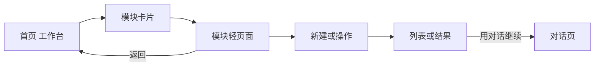
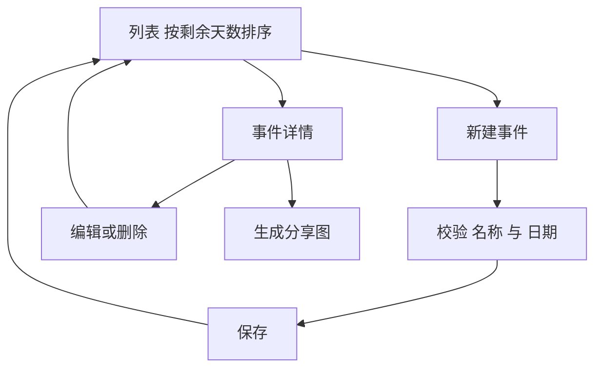
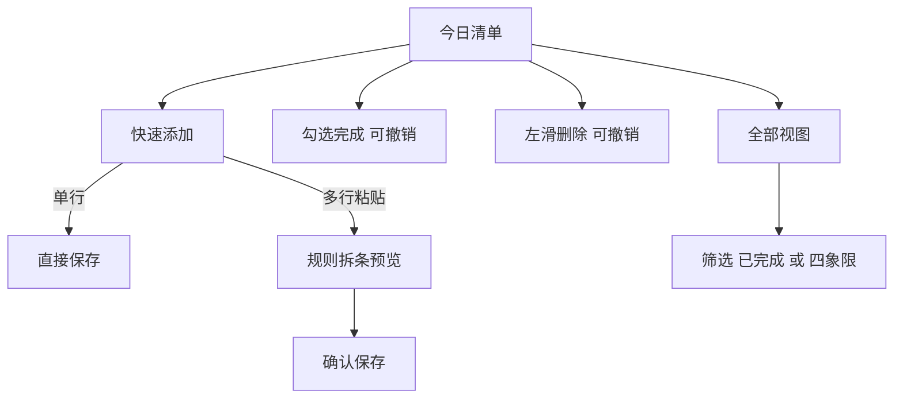
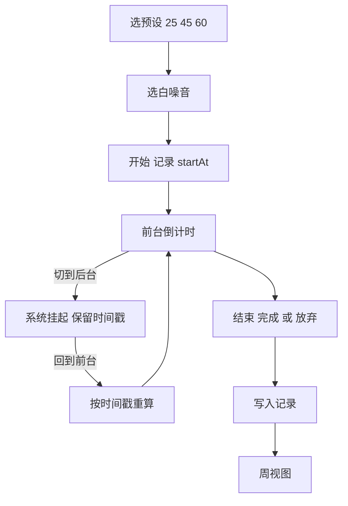
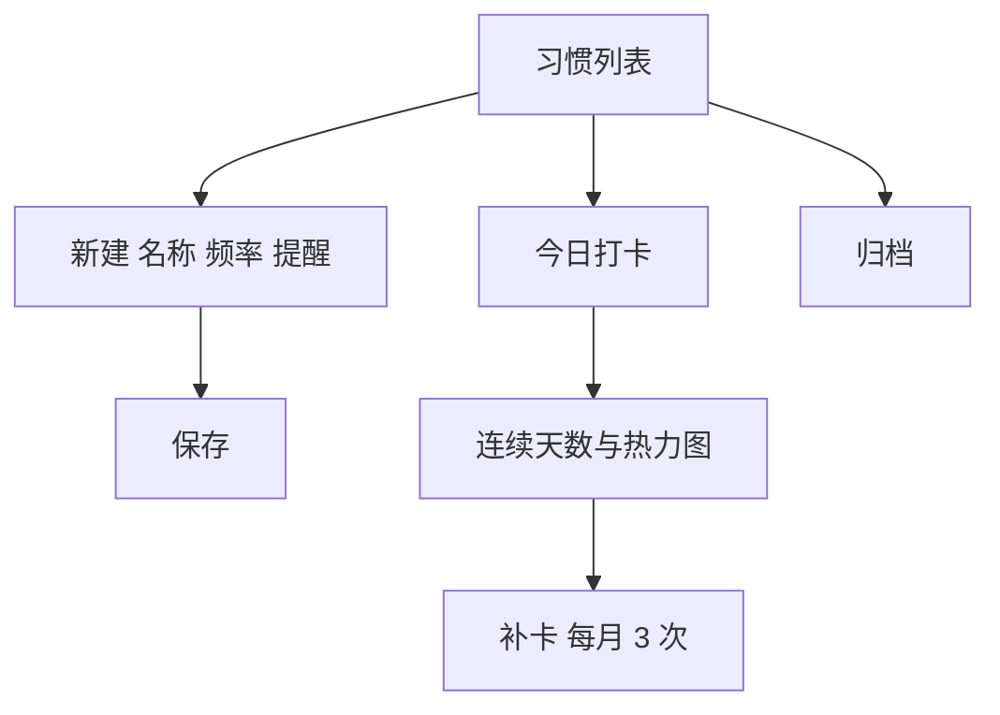
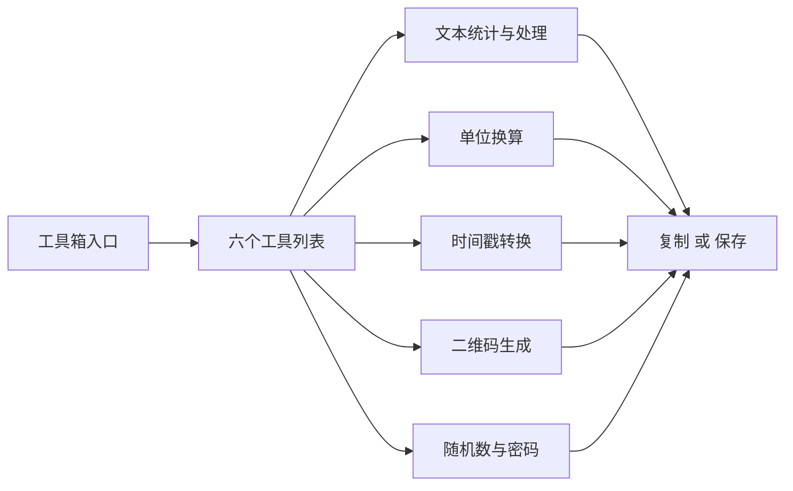

# 长伴 · 首期五模块：注册表定义与页面流程

## v0.1（开发交接版）

| 项目 | 内容 |
| --- | --- |
| 版本 | v0.1 |
| 日期 | 2026-11-24 |
| 范围 | 倒数日、今日待办、专注计时、习惯打卡、随身工具箱 |
| 前置文档 | 《长伴 · 首期「非 AI 基础模块」选品与开发方案 v0.1》 |
| 配套文件 | `长伴-模块注册表.sample.json` |

---

## 1. 交付范围

本期只做五件事，且全部**不调用大模型**：

| 模块 | module_id | 类型 | 核心动作 |
| --- | --- | --- | --- |
| 倒数日 | countdown | 视图型 | 建事件 → 看天数 |
| 今日待办 | todo | 视图型 | 记一条 → 勾掉 |
| 专注计时 | focus | 工具型 | 选时长 → 计时 → 留记录 |
| 习惯打卡 | habit | 视图型 | 打卡 → 看连续天数 |
| 随身工具箱 | toolbox | 工具型 | 选工具 → 出结果 → 复制 |

**共性约束**

- 无网络也能完成核心动作；联网后静默同步。
- 不涉及生成内容，无需 AI 内容标识。
- 所有页面复用首页模块卡片与既有视觉 token，不新增底部 Tab。

---

## 2. 模块注册表

### 2.1 公共字段

| 字段 | 类型 | 必填 | 说明 |
| --- | --- | --- | --- |
| schema_version | int | 是 | 注册表结构版本，当前 1 |
| module_id | string | 是 | 全局唯一，创建后不可改 |
| name / subtitle | string | 是 | 卡片标题 / 一句话说明 |
| category | enum | 是 | work / study / life |
| icon | string | 是 | 图标名，客户端内置图标库 |
| type | enum | 是 | conversation / tool / view |
| version | semver | 是 | 模块自身版本 |
| status | enum | 是 | draft / published / offline |
| sort_weight | int | 是 | 模块库默认排序，越大越靠前 |
| audience | object | 是 | mode: all / ratio / whitelist；ratio 为百分比 |
| min_client | semver | 是 | 低于此版本不下发 |
| tier | enum | 是 | free / pro |
| offline | bool | 是 | 是否支持离线核心操作 |
| ai | object | 是 | 非 AI 模块填 null / [] / none |
| entry | object | 是 | mode: page；page 为页面路径 |
| storage | object | 是 | collections、local_cache、sync |
| limits | object | 否 | 免费额度 |
| subscribe | object | 否 | 订阅消息模板与场景 |
| handoff | object | 否 | 是否可带入对话，context_key |
| telemetry | string[] | 是 | 埋点事件名 |

### 2.2 类型差异

| type | 额外字段 | 说明 |
| --- | --- | --- |
| view | views[] | 页面内视图列表，如 today / all / stats |
| tool | tabs[] | 工具二级页签，tools 模块用 |
| conversation | prompt_ref、tools[]、model_policy | 本期不使用 |

### 2.3 五条实际配置（摘要）

| 字段 | countdown | todo | focus | habit | toolbox |
| --- | --- | --- | --- | --- | --- |
| type | view | view | tool | view | tool |
| category | life | work | work | life | life |
| entry.page | pages/mod-countdown/index | pages/mod-todo/index | pages/mod-focus/index | pages/mod-habit/index | pages/mod-toolbox/index |
| collections | anniversaries | todos | focus_sessions | habits, habit_logs | — |
| local_cache | 是 | 是 | 是 | 是 | 是 |
| sync | 是 | 是 | 是 | 是 | 否 |
| offline | 是 | 是 | 是 | 是 | 是 |
| limits | 免费 20 条 | 免费 300 条未完成 | 历史保留 90 天 | 免费 5 个习惯 | — |
| subscribe | 事件提醒 | 到期提醒 | 结束提醒 | 每日提醒 | — |
| handoff | 是 | 是 | 是 | 否 | 是 |

完整可下发样例见 `长伴-模块注册表.sample.json`。

### 2.4 下发与版本兼容

- 客户端启动时带 `client_version` 拉取 `/v1/modules`，服务端按 `min_client`、`audience`、`status` 过滤后下发。
- 新增模块只改后台配置，**不触发小程序发版**。
- 下架模块：客户端保留已添加卡片并置灰，点击提示「已下线」，允许移除；用户数据不删。
- 客户端对未知字段忽略，对未知 `type` 不渲染——保证旧版本安全。

---

## 3. 数据模型

数据库可用文档型或关系型，字段语义一致。所有表均含 `user_id`、`created_at`、`updated_at`；删除一律软删 `deleted_at`。

### 3.1 集合定义

**anniversaries（倒数日）**

| 字段 | 类型 | 说明 |
| --- | --- | --- |
| id | string | uuid |
| title | string | ≤ 20 字 |
| event_date | string | YYYY-MM-DD，**本地日历日**，不做时区换算 |
| direction | enum | countdown 倒数 / since 正数 |
| repeat_yearly | bool | 每年重复 |
| color | string | token 名，6 选 1 |
| sort | int | 手动排序 |
| deleted_at | string? | 软删 |

**todos（待办）**

| 字段 | 类型 | 说明 |
| --- | --- | --- |
| id | string | uuid |
| title | string | ≤ 200 字 |
| note | string? | ≤ 1000 字 |
| due_date | string? | YYYY-MM-DD |
| quadrant | int? | 0 无 / 1 重要紧急 / 2 重要 / 3 紧急 |
| done | bool | 是否完成 |
| done_at | string? | 完成时间 |
| source | enum | manual / paste |
| sort | int | 排序 |

**habits / habit_logs（习惯与打卡）**

| 集合 | 字段 | 说明 |
| --- | --- | --- |
| habits | id, name, icon, color | 习惯定义 |
| habits | freq_type | daily / weekly |
| habits | freq_times | 每周次数，daily 时为 7 |
| habits | reminder_enabled, reminder_time | 提醒开关与 HH:mm |
| habits | archived | 归档标记 |
| habit_logs | habit_id, log_date | log_date 为 YYYY-MM-DD，唯一索引 habit_id + log_date |

**focus_sessions（专注记录）**

| 字段 | 类型 | 说明 |
| --- | --- | --- |
| id | string | uuid |
| started_at | string | ISO8601，含时区偏移 |
| ended_at | string? | 结束时写入 |
| planned_minutes | int | 25 / 45 / 60 |
| actual_seconds | int | 实际时长 |
| sound | string? | 白噪音标识 |
| completed | bool | 完成 / 放弃 |

### 3.2 离线与同步规则

| 规则 | 做法 |
| --- | --- |
| 写操作 | 客户端生成 `client_op_id`，写本地队列，立即更新 UI |
| 同步 | 联网后 POST `/v1/sync/batch`，按 op 顺序提交 |
| 幂等 | 服务端以 `client_op_id` 去重，重复提交返回首次结果 |
| 冲突 | 同一条记录以 `updated_at` 较新者为准（LWW） |
| 删除 | 软删 + 本地标记，30 天后清理 |
| 跨天 | 打卡与待办一律用**设备本地日期**判定，避免 UTC 偏移导致「昨天打卡变今天」 |
| 时区 | 用户在异地旅行时，记录保留创建时的本地日期，不做追溯改写（V1 接受） |

---

## 4. 页面与流程

### 4.1 全局壳

- 模块页顶部固定：返回、标题、右侧「用对话继续」。
- 「用对话继续」把当前对象作为上下文带入聊天（如某条待办、某个倒数日），由 `handoff.context_key` 决定拼装方式。
- 工具箱无对象上下文，带入的是「当前工具 + 输入内容」。

### 4.2 倒数日

页面：列表、新建/编辑（同一页面，不同态）、详情（可选，v1 可与编辑合并）、分享图预览。

边界状态：

| 场景 | 处理 |
| --- | --- |
| 空态 | 展示 2 条示例事件 + 「记录第一个日子」按钮 |
| 日期已过去且为倒数 | 自动切换为「已过 N 天」，并提示可改成正数 |
| 2 月 29 日的年度事件 | 平年按 3 月 1 日显示，并在编辑页说明 |
| 免费额度满 | 新建按钮置灰，提示删除或升级 |

### 4.3 今日待办

**规则拆条**（不用模型）：按换行、分号、句号拆分；去掉空行与行首序号（如 `1.`、`-`）；每条 ≤ 200 字；超过 10 条时提示分批。

边界状态：

| 场景 | 处理 |
| --- | --- |
| 离线新增 | 立即可见，右上角显示「待同步」小点 |
| 昨日未完成 | 今日页顶部单独「逾期」分组，不自动搬运日期 |
| 删除/完成误触 | 底部 3 秒撤销条 |
| 批量拆条为空 | 提示「没识别到可拆分的条目」 |

### 4.4 专注计时

边界状态：

| 场景 | 处理 |
| --- | --- |
| 切后台或锁屏 | 不做常驻，回前台用 `Date.now() - startAt` 重算 |
| 回来后已超时 | 直接结算为完成，展示「已结束 N 分钟前」 |
| 中途退出小程序 | 下次进入检测未结算 session，补结算或询问保留 |
| 未授权订阅消息 | 结束时只在页面内提示，不弹推送 |
| 白噪音被打断 | 来电或语音后恢复播放，用户可手动关闭 |

### 4.5 习惯打卡

边界状态：

| 场景 | 处理 |
| --- | --- |
| 每周 N 次 | 按自然周统计，周一起算；进度显示 3/5 |
| 跨天 | 0 点后打卡算新一天；0 点前 1 分钟内给「昨天的卡」二次确认 |
| 补卡 | 只能补过去 30 天，每月 3 次，热力图上用空心点区分 |
| 归档 | 保留历史记录，不再出现在今日列表 |
| 新建超限 | 免费 5 个，提示归档旧习惯或升级 |

### 4.6 随身工具箱

- 全部本地计算，不请求网络。
- 二维码用本地库在 canvas 绘制并保存到相册，需相册授权。
- 结果页统一底部操作：复制、清空、带入对话。
- 工具箱内部用二级列表，不占用首页多个卡片位。

---

## 5. 接口清单

| 方法 | 路径 | 说明 |
| --- | --- | --- |
| GET | /v1/modules?client_version= | 拉取注册表 |
| GET | /v1/anniversaries | 列表 |
| POST | /v1/anniversaries | 新建 |
| PATCH | /v1/anniversaries/{id} | 编辑 |
| DELETE | /v1/anniversaries/{id} | 软删 |
| GET | /v1/todos?scope=today\|all | 待办列表 |
| POST | /v1/todos | 新建（支持批量，最多 20 条） |
| PATCH | /v1/todos/{id} | 完成、编辑、排序 |
| DELETE | /v1/todos/{id} | 软删 |
| GET | /v1/habits | 习惯列表 |
| POST | /v1/habits | 新建 |
| PATCH | /v1/habits/{id} | 编辑、归档 |
| POST | /v1/habits/{id}/check | 打卡或取消 |
| POST | /v1/habits/{id}/makeup | 补卡 |
| POST | /v1/focus-sessions | 开始 |
| PATCH | /v1/focus-sessions/{id} | 结算 |
| GET | /v1/focus-sessions?from=&to= | 周视图 |
| POST | /v1/sync/batch | 离线队列批量提交 |
| POST | /v1/telemetry/batch | 埋点批量上报 |

约定：全部需登录态；`X-Client-Version`、`X-Device-Id` 随请求携带；错误统一 `code + message`。

---

## 6. 订阅消息接入

| 事项 | 做法 |
| --- | --- |
| 模板申请 | 在小程序后台申请「专注结束提醒」「习惯打卡提醒」「待办到期提醒」三个模板，提前 3 个工作日 |
| 模板下发 | 模板 ID 写进注册表 `subscribe.template_id`，服务端下发，客户端不硬编码 |
| 授权时机 | 创建提醒、开始专注时各请求一次；不在启动时弹 |
| 一次性限制 | 一次授权只能下发一条，因此每次关键动作前按需请求 |
| 降级 | 未授权时，进入小程序展示「离线期间的提醒卡」，不依赖推送 |

---

## 7. 埋点

| 事件 | 参数 | 用途 |
| --- | --- | --- |
| module_open | module_id, from | 入口有效性 |
| countdown_create / share | module_id | 创建率、传播 |
| todo_create | source, count | 拆条使用率 |
| todo_complete | — | 完成率 |
| focus_start / finish | planned_minutes, actual_seconds | 使用深度 |
| habit_check | habit_id, streak | 留存 |
| tool_use | tool_id | 工具热度 |
| handoff_to_chat | module_id | 模块与对话的联动 |

---

## 8. 验收清单

**通用**：弱网/断网可用；冷启动模块页 < 1s；返回不丢状态；深色模式正常；无弹窗教学。

| 模块 | 验收点 |
| --- | --- |
| 倒数日 | 新建/编辑/软删；跨年重复；过去日期自动切换；分享图可保存；20 条上限提示 |
| 待办 | 单行与多行拆条；批量 20 条上限；撤销；逾期分组；离线新增后同步成功 |
| 专注 | 切后台回前台时间准确（误差 < 1s）；超时自动结算；中断恢复；周视图统计正确 |
| 打卡 | 连续天数正确；每周 N 次按自然周；补卡上限；跨天边界；归档后历史保留 |
| 工具箱 | 六个工具全部本地可用；复制成功提示；二维码需授权时有引导；无网络不报错 |

---

## 9. 排期与依赖

| 周 | 交付 | 依赖 |
| --- | --- | --- |
| W1 | 注册表下发、模块容器、倒数日、工具箱 | 图标库、CDN |
| W2 | 待办、云同步与离线队列 | 同步服务先于模块联调 |
| W3 | 打卡、专注、订阅消息 | 模板审核通过 |
| W4 | 联调、包体与性能、提审灰度 | 主体与类目就绪 |

关键路径：**同步服务**（W2 前必须可用）与**订阅消息模板审核**（W1 提交）。任何一项延期，先保倒数日与工具箱上线。

---

## 10. 待确认

| 编号 | 事项 | 建议默认 |
| --- | --- | --- |
| Q1 | 免费额度 20/300/5 是否合适 | 先按此上线，用埋点校准 |
| Q2 | v1 是否必须云同步 | 建议必须，否则换机丢数据违背承诺 |
| Q3 | 订阅消息模板归属主体是否已具备 | W1 立即申请 |
| Q4 | 分享图是否带小程序码 | 带，便于传播 |

---

📦 本文档与注册表 JSON 可直接移交开发：模块配置进后台，页面按第 4 章实现，接口按第 5 章联调。
